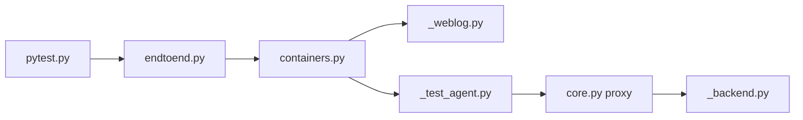

# DataDog/system-tests

> Black-box test bench that runs the same tests on Datadog's tracing libraries across ten languages.

## The problem
Ensuring a tracing feature behaves the same in Java, Python, Node, PHP, Ruby, Go and others.

## What it actually does
A scenario launches containers: an instrumented test application (weblog), a test agent, a proxy that intercepts traffic, and a simulated backend. Validators check traces and signals at the interfaces. Parametric scenarios, OpenTelemetry, AppSec, SSI/Kubernetes.

## How it is wired


## Trying it
```bash
./build.sh python
./run.sh
./run.sh SCENARIO_NAME
```

## Cost and gotchas
Docker 20.10+, Python 3.12; Kubernetes (Kind/Minikube) and AWS/Pulumi for some scenarios.

## What it is not
Not a generic testing tool: it targets Datadog tracers.

## Alternatives
No alternative named in the README.

## For you
Watch: the "same tests, several implementations, containers and proxy" pattern is reusable for testing multi-language clients.
