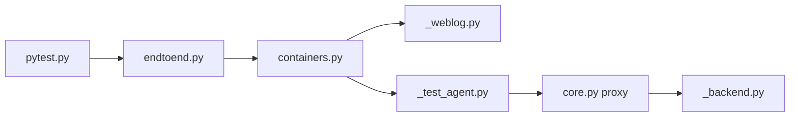

# DataDog/system-tests

> Banc de test boîte noire qui exécute les mêmes tests sur les bibliothèques de tracing Datadog de dix langages.

## Le problème
Garantir qu'une fonctionnalité de traçage se comporte pareil en Java, Python, Node, PHP, Ruby, Go et autres.

## Ce que ça fait vraiment
Un scénario lance des conteneurs : application de test (weblog) instrumentée, agent de test, proxy qui intercepte le trafic, backend simulé. Des validateurs vérifient traces et signaux aux interfaces. Scénarios paramétriques, OpenTelemetry, AppSec, SSI/Kubernetes.

## Comment c'est branché


## Essayer
```bash
./build.sh python
./run.sh
./run.sh SCENARIO_NAME
```

## Coût et pièges
Docker 20.10+, Python 3.12 ; Kubernetes (Kind/Minikube) et AWS/Pulumi pour certains scénarios.

## Ce que ce n'est pas
Pas un outil de test générique : il cible les traceurs Datadog.

## Alternatives
Aucune alternative nommée dans le README.

## Pour toi
À surveiller : le patron « mêmes tests, plusieurs implémentations, conteneurs et proxy » est réutilisable pour tester des clients multi-langages.

