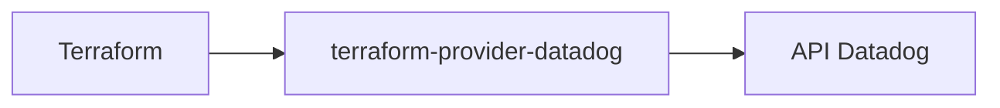

# DataDog/terraform-provider-datadog

> Official Terraform provider for managing Datadog resources as code.

## The problem
Datadog monitors, dashboards and SLOs created in the interface drift and are not reproducible.

## What it actually does
The provider lets you declare Datadog resources in Terraform. The README provided is short: Terraform 1.1.5 or later is required, build instructions use `make build` from the `$GOPATH` path, and it points to the Terraform registry for documentation and usage. The catalogue of resources is not in this README.

## How it is wired
No diagram provided: simple schema drawn from the README.


## Trying it
```sh
mkdir -p $GOPATH/src/github.com/DataDog; cd $GOPATH/src/github.com/DataDog
git clone git@github.com:DataDog/terraform-provider-datadog
cd $GOPATH/src/github.com/DataDog/terraform-provider-datadog
make build
```

## Cost and gotchas
A Datadog account is required (paid with a trial offer, depending on the provider). The provider is built from `$GOPATH`, even for forks. 454 open issues.

## What it is not
Not a monitoring tool: it only configures Datadog. The README does not detail the supported resources.

## Alternatives
The README names no alternative.

## For you
Keep an eye on it: useful if you monitor your models in Datadog and want to version that setup, of no interest otherwise.
