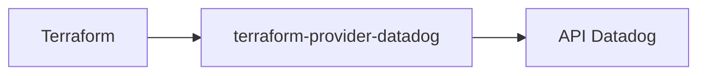

# DataDog/terraform-provider-datadog

> Fournisseur Terraform officiel pour gérer en code les ressources Datadog.

## Le problème
Moniteurs, tableaux de bord et SLO Datadog créés dans l'interface dérivent et ne sont pas reproductibles.

## Ce que ça fait vraiment
Le fournisseur permet de déclarer les ressources Datadog dans Terraform. Le README fourni est court : prérequis Terraform 1.1.5 ou plus, instructions de compilation avec `make build` depuis le chemin `$GOPATH`, et renvoi vers le registre Terraform pour la documentation et l'usage. Le catalogue des ressources n'est pas dans ce README.

## Comment c'est branché
Pas de diagramme fourni : schéma simple tiré du README.


## Essayer
```sh
mkdir -p $GOPATH/src/github.com/DataDog; cd $GOPATH/src/github.com/DataDog
git clone git@github.com:DataDog/terraform-provider-datadog
cd $GOPATH/src/github.com/DataDog/terraform-provider-datadog
make build
```

## Coût et pièges
Il faut un compte Datadog (payant avec offre d'essai, selon le fournisseur). Le fournisseur se compile depuis `$GOPATH`, même pour les forks. 454 issues ouvertes.

## Ce que ce n'est pas
Pas un outil de supervision : il ne fait que configurer Datadog. Le README ne détaille pas les ressources prises en charge.

## Alternatives
Le README ne nomme pas d'alternative.

## Pour toi
Surveiller : utile si tu supervises tes modèles dans Datadog et veux le versionner, sans intérêt sinon.

