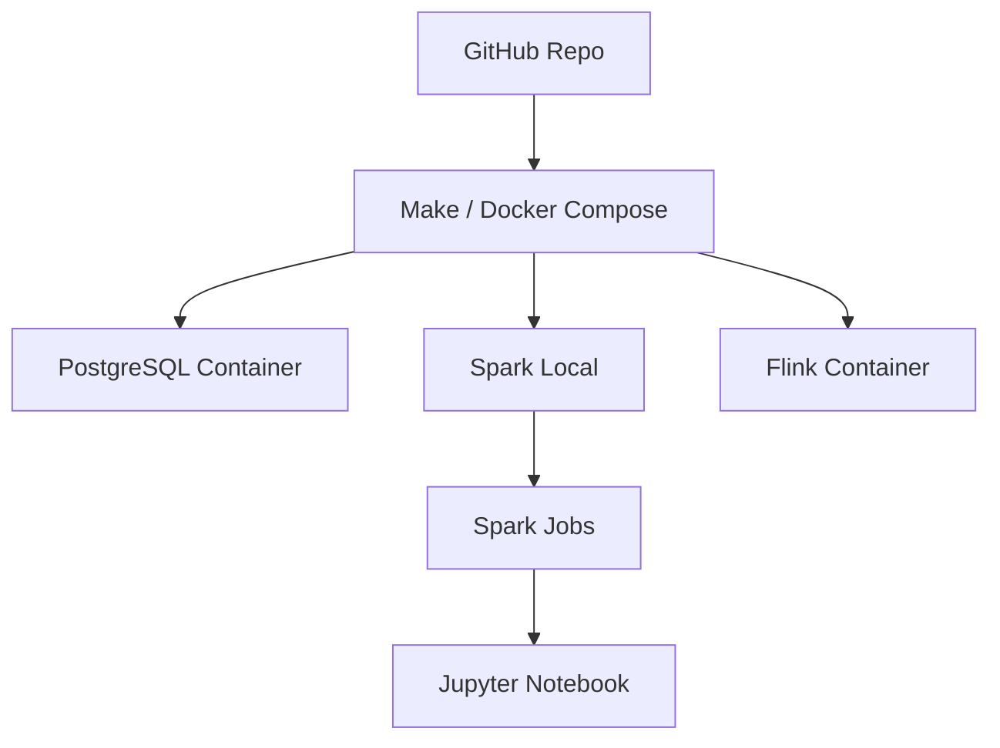

# DataExpert-io/data-engineer-handbook

> List of resources for learning data engineering: books, communities, courses, blogs, bootcamps.

## The problem
The resources for data engineering are scattered and of varying quality, with no central point of access.

## What it actually does
Index of books, communities, podcasts, glossaries, certifications, content creators, and tools by category. Also includes bootcamp materials (dimensional modeling, facts, Spark, Flink, KPIs) with Makefile, Docker Compose, and datasets.

## How it is wired

## Trying it
The README does not provide a command: read the introduction and the list of software from the bootcamp. According to the architecture: `make init` or `docker-compose up` for each module.

## Cost and gotchas
Free content; the DataExpert.io course is paid (discount code displayed). The README is also promotional for the editor.

## What it is not
Not a tool. No declared license: reuse of content is not guaranteed. Unsorted list, not ranked by quality.

## Alternatives
`DataTalksClub/data-engineering-zoomcamp` is referenced (as a structured and evaluated course).

## For you
To be used as a reference guide to address a gap in data engineering knowledge; up-to-date resources are more valuable than lab courses.
