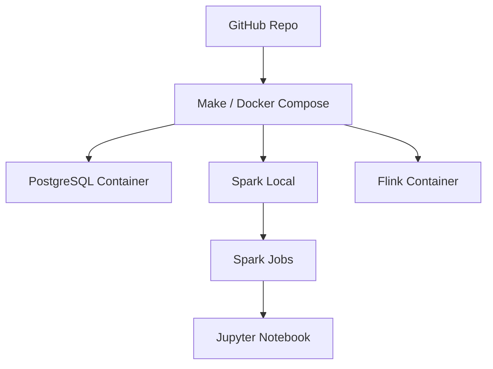

# DataExpert-io/data-engineer-handbook

> Liste de ressources pour apprendre le data engineering : livres, communautés, cours, blogs, bootcamp.

## Le problème
Les ressources de data engineering sont dispersées et leur qualité est inégale, sans point d'entrée.

## Ce que ça fait vraiment
Index de livres, communautés, podcasts, glossaires, certifications, créateurs de contenu et outils par catégorie. Contient aussi des supports de bootcamp (modélisation dimensionnelle, faits, Spark, Flink, KPI) avec Makefile, Docker Compose et jeux de données.

## Comment c'est branché

## Essayer
Le README ne donne pas de commande : lire l'introduction et la liste des logiciels du bootcamp. D'après l'architecture : `make init` ou `docker-compose up` par module.

## Coût et pièges
Contenu gratuit ; le cours DataExpert.io est payant (code de réduction affiché). Le README est aussi promotionnel pour l'éditeur.

## Ce que ce n'est pas
Pas un outil. Pas de licence déclarée : la réutilisation du contenu n'est pas garantie. Liste non triée par qualité.

## Alternatives
`DataTalksClub/data-engineering-zoomcamp` est cité (cours structuré et noté).

## Pour toi
À adopter comme carnet de références pour combler une lacune en data engineering ; les liens à jour valent plus que les labs.

