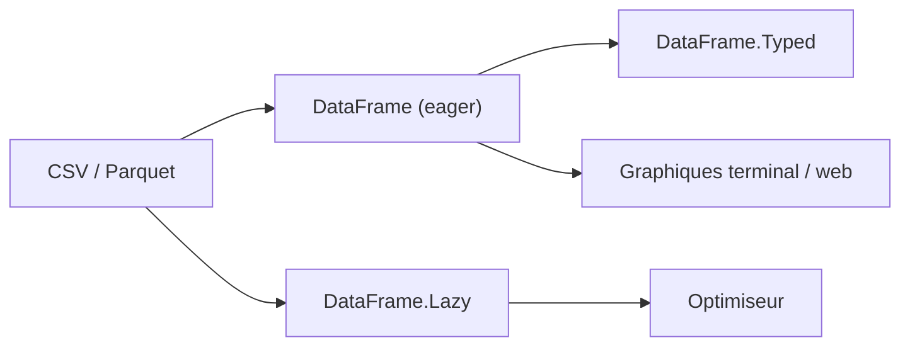

# DataHaskell/dataframe

> Haskell tabular analysis library, eager or lazy, with a typed API and a dedicated REPL.

## The problem
Doing table analysis in Haskell without resorting to custom code, while keeping the language's static typing.

## What it actually does
- Eager API (`DataFrame`), typed (`DataFrame.Typed`), lazy (`DataFrame.Lazy`) and typed lazy, with the same operation names.
- Reading CSV and Parquet, Hugging Face datasets via a separate package.
- Generation of typed columns and schemas from a CSV or a record type (Template Haskell).
- The lazy engine pushes filters down into the scan and reads only the useful columns.

## How it is wired
Simplified diagram based on the sheet, no diagram provided.


## Trying it
```bash
cabal update
cabal install dataframe
dataframe
```
In the REPL: `df = D.fromColumns [...]`, then `df |> D.groupBy ["product"] ...`.

## Cost and gotchas
Free. Requires a Haskell toolchain (GHC 9.4 to 9.12 and cabal), not provided. The README is itself an executable notebook: some examples depend on `./data`.

## What it is not
Not a replacement for pandas or Polars in a Python ecosystem: it is for Haskell projects. No numerical benchmark in the README.

## Alternatives
- pandas: the dominant Python ecosystem (migration guide cited).
- Polars: lazy engine in Rust, cited with a migration guide.
- Frames: earlier Haskell library, cited with a migration guide.

## For you
Worth watching out of curiosity if you do Haskell; in Python, nothing to gain, and the announced "symbolic AI" part is not detailed.
