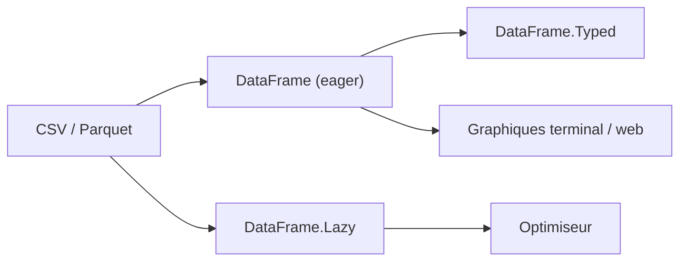

# DataHaskell/dataframe

> Bibliothèque Haskell d'analyse tabulaire, eager ou lazy, avec API typée et REPL dédié.

## Le problème
Faire de l'analyse de tableaux en Haskell sans passer par du code sur mesure, tout en gardant le typage statique du langage.

## Ce que ça fait vraiment
- API eager (`DataFrame`), typée (`DataFrame.Typed`), lazy (`DataFrame.Lazy`) et lazy typée, avec les mêmes noms d'opérations.
- Lecture CSV et Parquet, jeux Hugging Face via un paquet à part.
- Génération de colonnes et de schémas typés depuis un CSV ou un type enregistrement (Template Haskell).
- Le moteur lazy pousse les filtres dans le scan et ne lit que les colonnes utiles.

## Comment c'est branché
Schéma simplifié d'après la fiche, sans diagramme fourni.


## Essayer
```bash
cabal update
cabal install dataframe
dataframe
```
Dans le REPL : `df = D.fromColumns [...]`, puis `df |> D.groupBy ["product"] ...`.

## Coût et pièges
Gratuit. Demande une chaîne Haskell (GHC 9.4 à 9.12 et cabal), non fournie. Le README est lui-même un notebook exécutable : certains exemples dépendent de `./data`.

## Ce que ce n'est pas
Pas un remplaçant de pandas ou Polars dans un écosystème Python : c'est pour des projets Haskell. Pas de benchmark chiffré dans le README.

## Alternatives
- pandas : l'écosystème Python dominant (guide de migration cité).
- Polars : moteur lazy en Rust, cité avec un guide de migration.
- Frames : bibliothèque Haskell antérieure, citée avec un guide de migration.

## Pour toi
À surveiller par curiosité si tu fais du Haskell ; en Python, rien à gagner, et la partie « IA symbolique » annoncée n'est pas détaillée.

