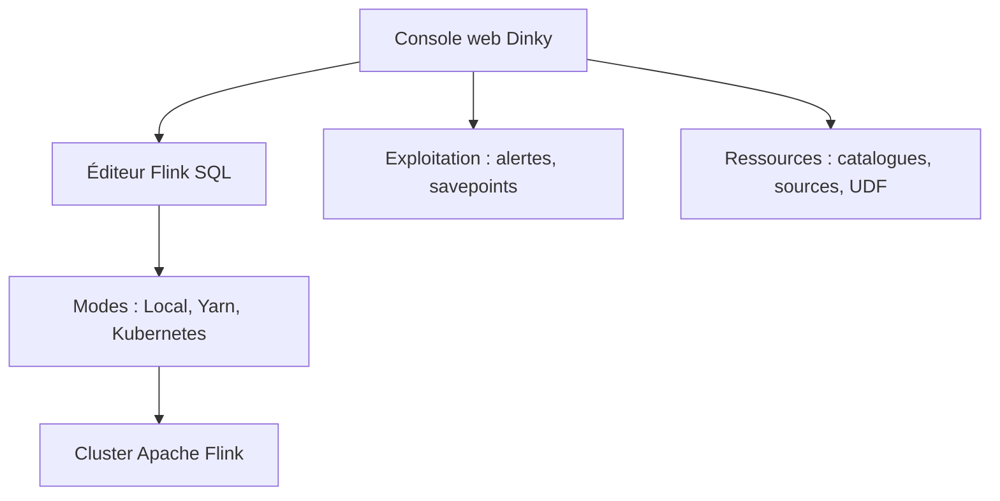

# DataLinkDC/dinky

> Real-time computing platform built around Apache Flink, for developing and operating Flink SQL jobs.

## The problem
Writing, debugging, deploying and monitoring Flink SQL jobs requires multiple tools and hand-made scripts.

## What it actually does
A web console for Flink SQL: completion, syntax checking, logical plan, catalog, lineage, version comparison, online debugging. Supports several execution modes (Local, Standalone, Yarn, Kubernetes), FlinkCDC, Paimon, PyFlink. Adds operations (savepoints, DingTalk, WeChat, Feishu and e-mail alerts) and multi-tenant management.

## How it is wired
Simplified diagram based on the sheet, no diagram supplied.

## Trying it
No command is documented in the README: it points to the site's documentation (build, installation, deployment).

## Cost and gotchas
Free, but you need a Flink environment (and often Yarn or Kubernetes) at your own expense. Installation goes through building from source.

## What it is not
Not a compute engine: it is a development and operations layer on top of Flink. The community is mostly Chinese-speaking (WeChat, QQ).

## Alternatives
- No alternative named in the README.

## For you
Worth watching: interesting if you do streaming on Flink and want a SQL studio with lineage, useless otherwise; the README gives few deployment details.
