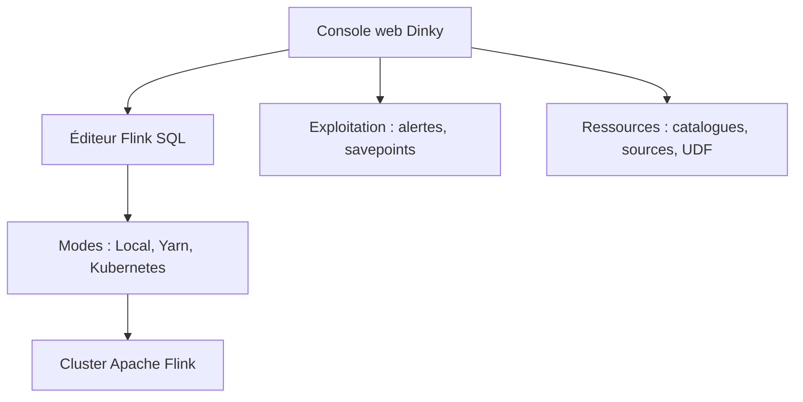

# DataLinkDC/dinky

> Plateforme de calcul temps réel autour d'Apache Flink, pour développer et exploiter des jobs Flink SQL.

## Le problème
Écrire, déboguer, déployer et surveiller des jobs Flink SQL demande de multiples outils et des scripts à la main.

## Ce que ça fait vraiment
Une console web pour Flink SQL : complétion, vérification de syntaxe, plan logique, catalogue, lignage, comparaison de versions, débogage en ligne. Prend en charge plusieurs modes d'exécution (Local, Standalone, Yarn, Kubernetes), FlinkCDC, Paimon, PyFlink. Ajoute exploitation (savepoints, alertes DingTalk, WeChat, Feishu, e-mail) et gestion multi-tenant.

## Comment c'est branché
Schéma simplifié d'après la fiche, sans diagramme fourni.

## Essayer
Aucune commande n'est documentée dans le README : il renvoie vers la documentation du site (compilation, installation, déploiement).

## Coût et pièges
Gratuit, mais il faut un environnement Flink (et souvent Yarn ou Kubernetes) à ta charge. L'installation passe par la compilation depuis le source.

## Ce que ce n'est pas
Pas un moteur de calcul : c'est une surcouche de développement et d'exploitation pour Flink. La communauté est surtout en chinois (WeChat, QQ).

## Alternatives
- Aucune alternative nommée dans le README.

## Pour toi
À surveiller : intéressant si tu fais du streaming sur Flink et veux un studio SQL avec lignage, inutile sinon ; le README donne peu de détails de déploiement.

