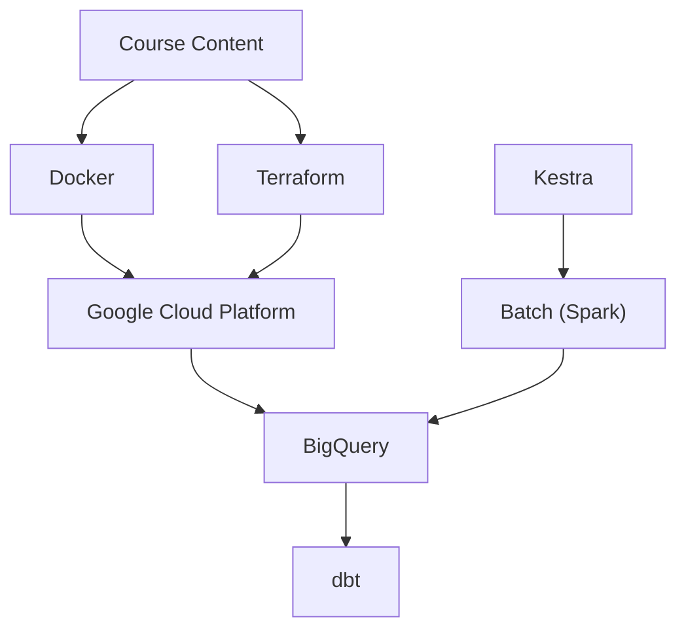

# DataTalksClub/data-engineering-zoomcamp

> A free nine-week course to learn how to build a complete data pipeline.

## The problem
Learning modern data engineering without a structured curriculum: scattered tools, no central project, and no feedback.

## What it actually does
Modules: Docker/Terraform, Kestra orchestration, BigQuery data warehouse, dbt, Bruin platform, Spark, Kafka, plus a final project. Pre-recorded videos, assignments, Slack. The "live cohort" does not have live classes: only deadlines, a grading system, and a certificate.

## How it is wired

## Trying it
There are no documented commands in the README: follow the module directories in the repository, the YouTube playlist, and the Slack channel.

## Cost and gotchas
The course is free, but the modules rely on GCP/BigQuery: you will need to create a cloud account, and any associated costs will be your responsibility. A certificate will be awarded to participants in the cohort (the next cohort is scheduled for January 2027).

## What it is not
This is not a tool or a library. There are no live classes. The self-paced mode does not include graded assessments or certificates.

## Alternatives
No alternative is specified in the README file.

## For you
This is a great option if you want a solid foundation in pipelines: it's free, well-structured, and covers the entire current stack, with a project for your portfolio.
