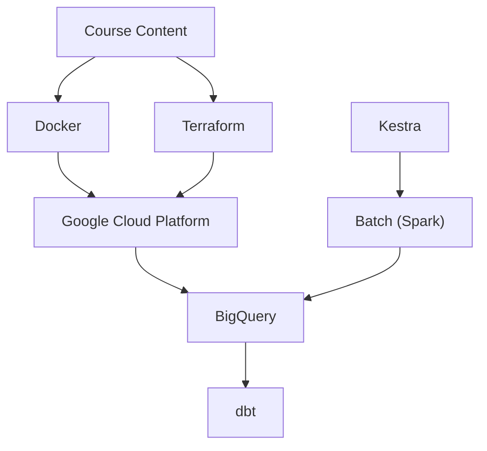

# DataTalksClub/data-engineering-zoomcamp

> Cours gratuit de neuf semaines pour apprendre à construire un pipeline de données de bout en bout.

## Le problème
Apprendre le data engineering moderne sans parcours structuré : outils éparpillés, pas de projet fil rouge, pas de retours.

## Ce que ça fait vraiment
Modules : Docker/Terraform, orchestration Kestra, entrepôt BigQuery, dbt, plateforme Bruin, Spark, Kafka, plus un projet final. Vidéos préenregistrées, devoirs, Slack. La « cohorte live » n'a pas de cours en direct : seulement des échéances, un classement et un certificat.

## Comment c'est branché

## Essayer
Aucune commande documentée dans le README : suivre les dossiers de modules du dépôt, la playlist YouTube et Slack.

## Coût et pièges
Le cours est gratuit, mais les modules s'appuient sur GCP/BigQuery : compte cloud à créer, facturation éventuelle à ta charge. Certificat réservé à la cohorte (prochaine : janvier 2027).

## Ce que ce n'est pas
Pas un outil ni une bibliothèque. Pas de cours en direct. Le mode autonome n'a ni correction notée ni certificat.

## Alternatives
Aucune alternative nommée dans le README.

## Pour toi
À adopter si tu veux une base solide en pipelines : c'est gratuit, structuré et couvre tout le stack courant, avec un projet pour le portfolio.

