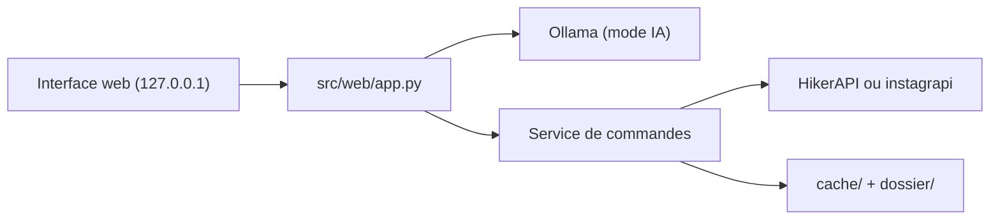

# Datalux/Osintgram

> Local web interface for OSINT analysis of public Instagram profiles, with an assisted mode using a local model.

## The problem
Gather and cross-reference what a public Instagram profile reveals (followers, captions, hashtags, locations, posting times).

## What it actually does
A web application (FastAPI, served on 127.0.0.1) offers 28 commands: profile, network, content, public contacts, hashtag or location searches. The AI mode uses Ollama locally to pick the commands; the base mode uses no model. It estimates the cost of a search, caches requests, displays maps and grids, and exports an HTML report.

## How it is wired


## Trying it
```bash
pip install -r requirements.txt
uvicorn src.web.app:app --host 127.0.0.1 --port 8000 --reload
ollama pull llama3.1:8b
docker compose up --build
```

## Cost and gotchas
Instagram data comes from a paid provider (HikerAPI key) or from an Instagram account of your own (instagrapi), which should not be your main account. No authentication on the interface: do not expose it beyond localhost. The key is stored in `config/credentials.ini`, which must never be committed. GPL-3.0.

## What it is not
It cannot see private profiles. The README describes it as "for educational purposes" and reminds you that the results contain personal data subject to GDPR and Instagram's terms.

## Alternatives
The README names HikerAPI and instagrapi as data providers, not as alternatives to the tool.

## For you
Ignore: OSINT on individuals, outside your profile, dependent on a paid provider and heavy on data-protection obligations.
