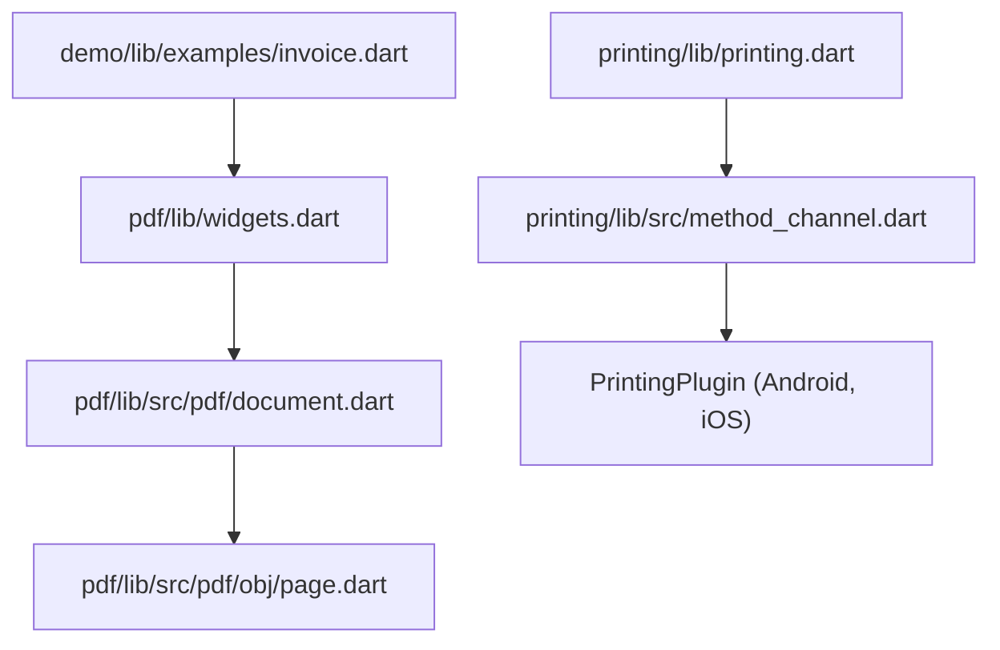

# DavBfr/dart_pdf

> Generate and print PDFs from Dart and Flutter, on iOS and Android.

## The problem
Produce a PDF (invoice, report) in a mobile application without going through an external service.

## What it actually does
Two packages: pdf builds a document with widgets and then serializes it into PDF objects; printing sends the result to the printer through a method channel to the native Android and iOS code. A demo folder contains examples, including an invoice.

## How it is wired

## Trying it
No command documented in the README: it only lists the pdf and printing packages and an online demo.

## Cost and gotchas
Free. Very short README: getting started goes through the packages' documentation. More than 380 open issues.

## What it is not
Not a PDF extractor or reader: it is for generating and printing.

## Alternatives
No alternative named in the README.

## For you
Ignore: Flutter PDF-generation library, outside your data/AI scope; worth keeping in mind only for a mobile application.
