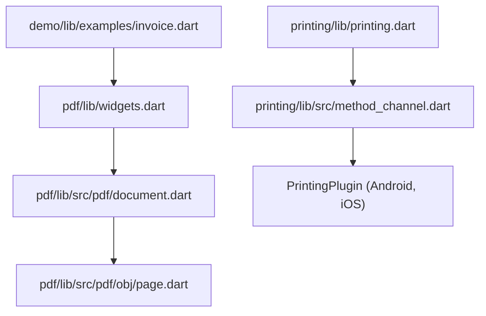

# DavBfr/dart_pdf

> Générer et imprimer des PDF depuis Dart et Flutter, sur iOS et Android.

## Le problème
Produire un PDF (facture, rapport) dans une application mobile sans passer par un service externe.

## Ce que ça fait vraiment
Deux paquets : pdf construit un document avec des widgets puis le sérialise en objets PDF ; printing envoie le résultat à l'imprimante via un canal de méthodes vers le code natif Android et iOS. Un dossier demo contient des exemples, dont une facture.

## Comment c'est branché

## Essayer
Aucune commande documentée dans le README : il liste seulement les paquets pdf et printing et une démo en ligne.

## Coût et pièges
Gratuit. README très court : la prise en main passe par la documentation des paquets. Plus de 380 issues ouvertes.

## Ce que ce n'est pas
Pas un extracteur ni un lecteur de PDF : il sert à générer et à imprimer.

## Alternatives
Aucune alternative nommée dans le README.

## Pour toi
Ignorer : bibliothèque Flutter de génération de PDF, hors de ton périmètre data/IA ; à garder en tête seulement pour une application mobile.

