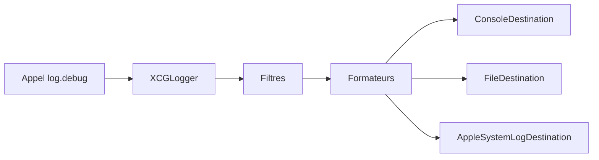

# DaveWoodCom/XCGLogger

> Debug logging module for Swift projects on Apple platforms, with file output, levels, filters and multiple destinations.

## The problem
Without preprocessor macros in Swift, `print` loses the date, file, line and function that emitted the message.

## What it actually does
Adds the date, level, file, line and function to every log. Sends messages to the console, a file (with automatic rotation), the system log or custom destinations. Offers filters by file, tag or developer, formatters (ANSI colors) and background queue processing. Closures avoid building messages that are not displayed.

## How it is wired
Simplified diagram based on the fiche, no diagram provided.


## Trying it
```bash
git submodule add https://github.com/DaveWoodCom/XCGLogger.git
```
Or Carthage: `github "DaveWoodCom/XCGLogger" ~> 7.1.5`, or CocoaPods: `pod 'XCGLogger', '~> 7.1.5'`. Then `let log = XCGLogger.default` and `log.setup(level: .debug, ...)`.

## Cost and gotchas
Free. Versions are tied to Swift versions (7.1.5 for Swift 5.0). The README mentions third-party color tools that no longer work in Xcode.

## What it is not
Not a monitoring tool nor remote collection: it sends nothing without a destination you write. The README is truncated and keeps "To Do" lists; last push in July 2024.

## Alternatives
No alternative named in the README.

## For you
Ignore: logging library limited to Swift/Apple, outside the data / AI / MLOps scope, and not very active since 2024.
