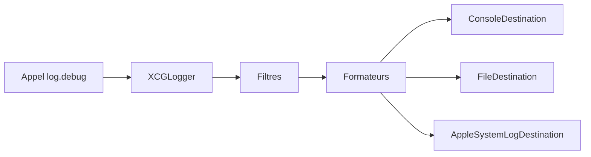

# DaveWoodCom/XCGLogger

> Module de journalisation de debug pour projets Swift sur Apple, avec fichier, niveaux, filtres et destinations multiples.

## Le problème
Sans macros préprocesseur en Swift, `print` perd la date, le fichier, la ligne et la fonction qui ont émis le message.

## Ce que ça fait vraiment
Ajoute à chaque log la date, le niveau, le fichier, la ligne et la fonction. Envoie les messages vers la console, un fichier (avec rotation automatique), le journal système ou des destinations personnalisées. Offre des filtres par fichier, tag ou développeur, des formateurs (couleurs ANSI) et le traitement en file d'arrière-plan. Les closures évitent de construire les messages non affichés.

## Comment c'est branché
Schéma simplifié d'après la fiche, sans diagramme fourni.


## Essayer
```bash
git submodule add https://github.com/DaveWoodCom/XCGLogger.git
```
Ou Carthage : `github "DaveWoodCom/XCGLogger" ~> 7.1.5`, ou CocoaPods : `pod 'XCGLogger', '~> 7.1.5'`. Puis `let log = XCGLogger.default` et `log.setup(level: .debug, ...)`.

## Coût et pièges
Gratuit. Les versions sont liées aux versions de Swift (7.1.5 pour Swift 5.0). Le README mentionne des outils tiers de couleur qui ne marchent plus dans Xcode.

## Ce que ce n'est pas
Pas un outil de monitoring ni de collecte distante : il n'envoie rien sans destination écrite par toi. Le README est tronqué et garde des listes « To Do » ; dernier push en juillet 2024.

## Alternatives
Aucune alternative nommée dans le README.

## Pour toi
À ignorer : bibliothèque de logs réservée à Swift/Apple, hors du périmètre data / IA / MLOps, et peu active depuis 2024.

