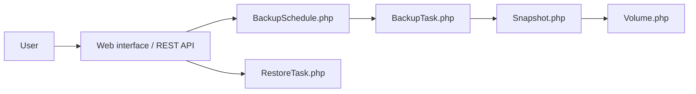

# David-Crty/databasement

> Self-hosted web application for managing database backups, for operations teams.

## The problem
Scheduling, storing and restoring dumps of MySQL, PostgreSQL, MongoDB etc. is done with scattered scripts, without tracking or alerts.

## What it actually does
Manages database servers, storage volumes (local, S3, Azure, SMB, SFTP) and backup schedules with retention (days or GFS). Gzip, zstd or AES-256 compression; cross-server restore; outbound remote agents over HTTPS; notifications (Slack, Email, Webhook...); REST API and MCP server; SSO and roles.

## How it is wired


## Trying it
```bash
docker run -d \
  --name databasement \
  -p 2226:2226 \
  -e DB_CONNECTION=sqlite \
  -e DB_DATABASE=/data/database.sqlite \
  -e ENABLE_QUEUE_WORKER=true \
  -v ./databasement-data:/data \
  davidcrty/databasement:1
```

## Cost and gotchas
Free; backup storage is at your expense. Database access goes through credentials that the tool keeps: protect them.

## What it is not
Not a replication or high-availability tool. The architecture provided is partial; the internal implementation is not documented here.

## Alternatives
No alternative named in the README.

## For you
Adopt to back up the databases of an MLOps project: a single container, multi-engine, MIT, recent activity.
