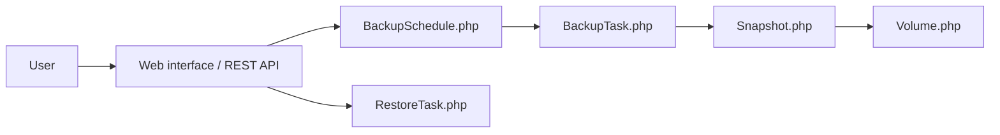

# David-Crty/databasement

> Application web auto-hébergée de gestion des sauvegardes de bases de données, pour équipes d'exploitation.

## Le problème
Planifier, stocker et restaurer des dumps de MySQL, PostgreSQL, MongoDB etc. se fait avec des scripts épars, sans suivi ni alertes.

## Ce que ça fait vraiment
Gère des serveurs de bases, des volumes de stockage (local, S3, Azure, SMB, SFTP) et des plannings de sauvegarde avec rétention (jours ou GFS). Compression gzip, zstd ou AES-256 ; restauration croisée entre serveurs ; agents distants sortants en HTTPS ; notifications (Slack, Email, Webhook…) ; API REST et serveur MCP ; SSO et rôles.

## Comment c'est branché


## Essayer
```bash
docker run -d \
  --name databasement \
  -p 2226:2226 \
  -e DB_CONNECTION=sqlite \
  -e DB_DATABASE=/data/database.sqlite \
  -e ENABLE_QUEUE_WORKER=true \
  -v ./databasement-data:/data \
  davidcrty/databasement:1
```

## Coût et pièges
Gratuit ; stockage de sauvegarde à ta charge. L'accès aux bases passe par des identifiants que l'outil conserve : à protéger.

## Ce que ce n'est pas
Pas un outil de réplication ni de haute disponibilité. L'architecture fournie reste partielle ; l'implémentation interne n'est pas documentée ici.

## Alternatives
Aucune alternative nommée dans le README.

## Pour toi
Adopter pour sauvegarder les bases d'un projet MLOps : un seul conteneur, multi-moteurs, MIT, activité récente.

