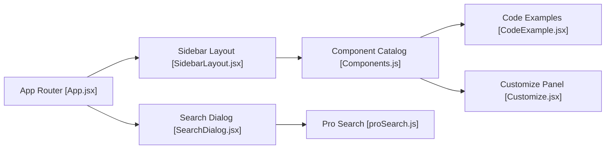

# DavidHDev/react-bits

> Library of more than 200 animated React components to copy, for text, backgrounds and micro-interactions.

## The problem
Writing interface animations yourself takes hours.

## What it actually does
A documentation site where you browse a catalog, edit a component's properties live and then copy the code. Each component exists in four variants (JS or TS, CSS or Tailwind). It also offers tools: Background Studio, Shape Magic, Texture Lab. Installation is done with shadcn or jsrepo.

## How it is wired


## Trying it
```bash
npx shadcn@latest add @react-bits/BlurText-TS-TW
```

## Cost and gotchas
Free according to the README. The license is "present but unidentified" by GitHub: check before reuse. A "Pro" catalog appears in the architecture with no detail in the README.

## What it is not
Not a package to import like a classic dependency: you copy the code into your project. The README says some components are inspired by public code.

## Alternatives
- Vue Bits (vue-bits.dev): port for Vue.
- Svelte Bits (sveltebits.xyz): port for Svelte.

## For you
Ignore: interface animations unrelated to data/AI work, with a license still to be clarified.
