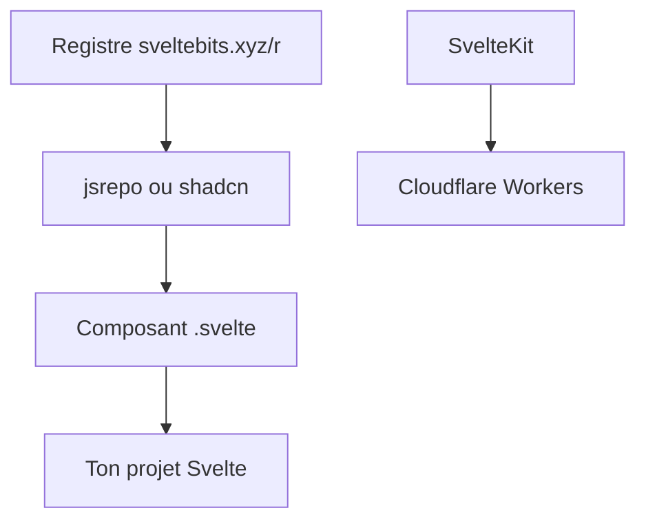

# DavidHDev/svelte-bits

> Library of animated Svelte components to copy and paste, a port of React Bits, for front-end developers.

## The problem
Hand-coding text, background and interface animations takes hours.

## What it actually does
Each component is a standalone `.svelte` file in TypeScript and Tailwind, with its original dependencies (shaders, physics). It is added by copy-paste, via jsrepo or via the shadcn CLI from registry URLs. The documentation site is built with SvelteKit's Cloudflare adapter.

## How it is wired
Simplified diagram based on the sheet, no diagram provided.


## Trying it
```bash
pnpm dlx jsrepo init https://sveltebits.xyz/r
pnpm dlx jsrepo add aurora
pnpm dlx shadcn@latest add https://sveltebits.xyz/r/aurora.json
npm install
npm run dev
```

## Cost and gotchas
Free. Node 20 or later for the site; Cloudflare hosting is optional. A license is present but not identified by GitHub: check it before reusing the code.

## What it is not
It is not a versioned package to import: you copy sources. It is limited to Svelte.

## Alternatives
- React Bits: the original of which this repository is the port.

## For you
Ignore: front-end animation components, unrelated to your data / AI work.
