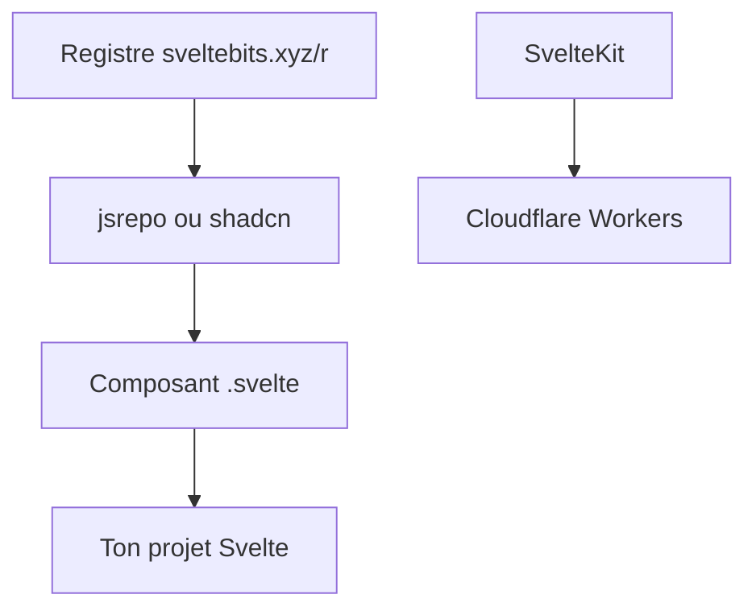

# DavidHDev/svelte-bits

> Bibliothèque de composants Svelte animés à copier-coller, port de React Bits, pour développeurs front-end.

## Le problème
Coder des animations de texte, de fonds et d'interface à la main prend des heures.

## Ce que ça fait vraiment
Chaque composant est un fichier `.svelte` autonome en TypeScript et Tailwind, avec ses dépendances d'origine (shaders, physique). On l'ajoute par copier-coller, par jsrepo ou par la CLI shadcn à partir d'URL de registre. Le site de documentation se construit avec l'adaptateur Cloudflare de SvelteKit.

## Comment c'est branché
Schéma simplifié d'après la fiche, sans diagramme fourni.


## Essayer
```bash
pnpm dlx jsrepo init https://sveltebits.xyz/r
pnpm dlx jsrepo add aurora
pnpm dlx shadcn@latest add https://sveltebits.xyz/r/aurora.json
npm install
npm run dev
```

## Coût et pièges
Gratuit. Node 20 ou plus pour le site ; l'hébergement Cloudflare est facultatif. Licence présente mais non identifiée par GitHub : à vérifier avant de réutiliser le code.

## Ce que ce n'est pas
Ce n'est pas un paquet versionné à importer : on copie des sources. Il se limite à Svelte.

## Alternatives
- React Bits : l'original dont ce dépôt est le port.

## Pour toi
À ignorer : composants d'animation front-end, sans lien avec ton travail data / IA.

