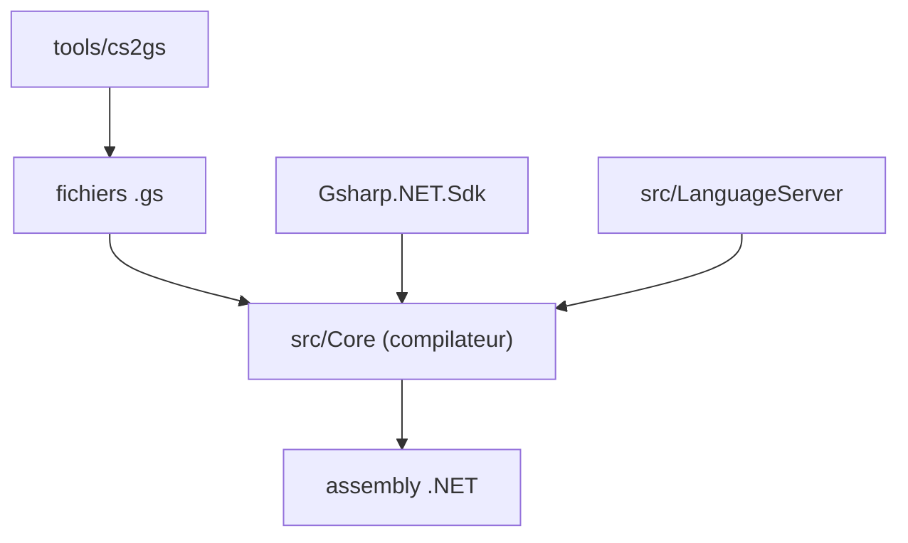

# DavidObando/gsharp

> Programming language for .NET with a syntax inspired by Go, Kotlin and Swift.

## The problem
Writing .NET in C# takes more ceremony than some developers would like.

## What it actually does
A compiler (`gsc`), an MSBuild SDK, a REPL (`gsi`), a formatter (`gsfmt`), a language server and a `cs2gs` tool for migrating C# to G#. Explicit nullability, data classes, `chan`, `go` and `scope {}` for structured concurrency. The produced assemblies are ordinary .NET assemblies.

## How it is wired
Simplified diagram based on the sheet, no diagram provided.


## Trying it
```bash
dotnet new install Gsharp.Templates
dotnet new gsharp-console -n MyApp
cd MyApp && dotnet run
```

## Cost and gotchas
Free. .NET 10 SDK required. 200 open issues; a young language, hence a limited tooling ecosystem.

## What it is not
It is not an implementation of Go: only an inspired syntax, on the CLR.

## Alternatives
No alternative named in the README.

## For you
Ignore: a new .NET language brings nothing to a data / AI profile working in Python.
