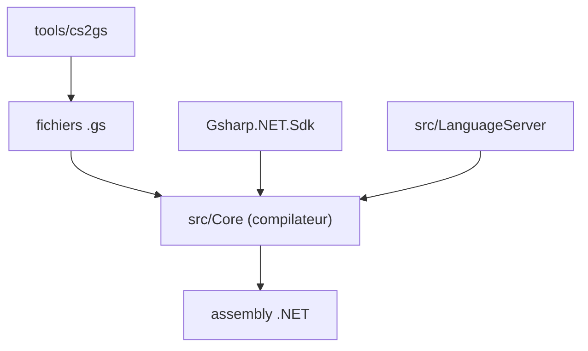

# DavidObando/gsharp

> Langage de programmation pour .NET à la syntaxe inspirée de Go, Kotlin et Swift.

## Le problème
Écrire du .NET en C# demande plus de cérémonie que certains développeurs ne le souhaitent.

## Ce que ça fait vraiment
Un compilateur (`gsc`), un SDK MSBuild, un REPL (`gsi`), un formateur (`gsfmt`), un serveur de langage et un outil `cs2gs` de migration C# vers G#. Nullabilité explicite, classes de données, `chan`, `go` et `scope {}` pour la concurrence structurée. Les assemblies produites sont des assemblies .NET ordinaires.

## Comment c'est branché
Schéma simplifié d'après la fiche, sans diagramme fourni.


## Essayer
```bash
dotnet new install Gsharp.Templates
dotnet new gsharp-console -n MyApp
cd MyApp && dotnet run
```

## Coût et pièges
Gratuit. SDK .NET 10 requis. 200 issues ouvertes ; un langage jeune, donc un écosystème d'outils limité.

## Ce que ce n'est pas
Ce n'est pas une implémentation de Go : seulement une syntaxe inspirée, sur le CLR.

## Alternatives
Aucune alternative nommée dans le README.

## Pour toi
À ignorer : un nouveau langage .NET n'apporte rien à un profil data / IA qui travaille en Python.

