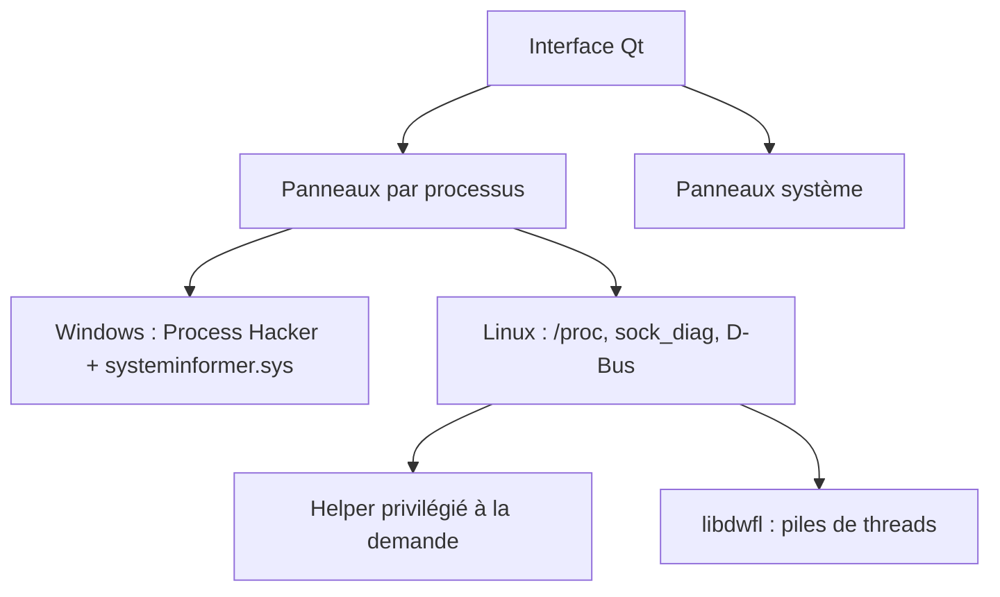

# DavidXanatos/TaskExplorer

> Qt task manager for Windows and Linux, for anyone who wants to see what processes are doing.

## The problem
Standard task managers show load, not what a process does: thread stacks, handles, sockets, memory.

## What it actually does
Shows per-process panels: threads with call stacks, editable memory, handles, sockets with throughput, modules. Adds system graphs (CPU, disk, network, GPU). On Linux, the native backend reads `/proc`, netlink and D-Bus, with extra Control Group and Security panels and a PSI graph. The Windows-specific panels (Token, GDI, .NET) are removed.

## How it is wired
Simplified diagram based on the write-up, no diagram provided.



## Trying it
```bash
cmake -S . -B build -G Ninja -DCMAKE_BUILD_TYPE=Release
cmake --build build
```
On Linux, standalone archives are published: unpack and run.

## Cost and gotchas
Free. On Linux, reading other users' memory or files requires the privileged helper (disabled by default). On Wayland, the Windows panel is empty.

## What it is not
Not a server observability tool nor a monitoring agent: it is a desktop application. The Heap panel is empty on Linux. On Windows, it relies on a separately compiled kernel driver.

## Alternatives
- Process Hacker / SystemInformer: technical base cited in the README, Windows side.

## For you
Worth watching: useful for diagnosing a hang or a leak on a workstation, with no direct link to the data/AI trade; the GPL-3.0 matters if you want to embed it.
