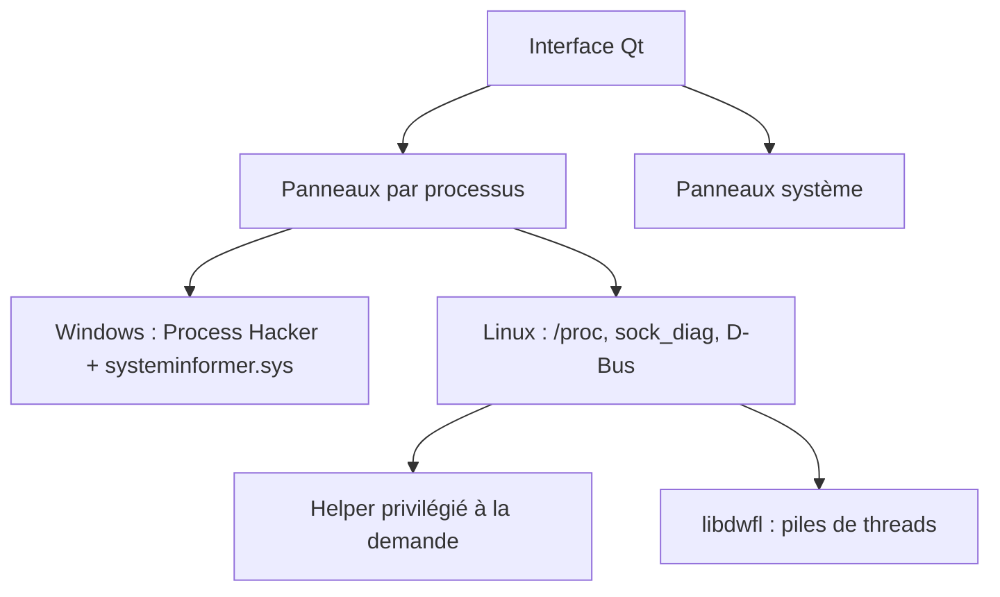

# DavidXanatos/TaskExplorer

> Gestionnaire de tâches Qt pour Windows et Linux, pour qui veut voir ce que font les processus.

## Le problème
Les gestionnaires de tâches standards montrent la charge, pas ce que fait un processus : piles de threads, handles, sockets, mémoire.

## Ce que ça fait vraiment
Affiche des panneaux par processus : threads avec pile d'appels, mémoire éditable, handles, sockets avec débit, modules. Ajoute des graphes système (CPU, disque, réseau, GPU). Sous Linux, le backend natif lit `/proc`, netlink et D-Bus, avec en plus les panneaux Control Group et Security et un graphe PSI. Les panneaux propres à Windows (Token, GDI, .NET) sont retirés.

## Comment c'est branché
Schéma simplifié d'après la fiche, sans diagramme fourni.



## Essayer
```bash
cmake -S . -B build -G Ninja -DCMAKE_BUILD_TYPE=Release
cmake --build build
```
Sous Linux, des archives autonomes sont publiées : à décompresser et lancer.

## Coût et pièges
Gratuit. Sous Linux, lire la mémoire ou les fichiers d'autres utilisateurs demande le helper privilégié (désactivé par défaut). Sous Wayland, le panneau Windows est vide.

## Ce que ce n'est pas
Pas un outil d'observabilité pour serveurs ni un agent de supervision : c'est une application de bureau. Le panneau Heap est vide sous Linux. Sous Windows, il repose sur un pilote noyau compilé à part.

## Alternatives
- Process Hacker / SystemInformer : base technique citée dans le README, côté Windows.

## Pour toi
À surveiller : utile pour diagnostiquer un blocage ou une fuite sur un poste de travail, sans lien direct avec le métier data/IA ; la GPL-3.0 compte si tu veux l'intégrer.

