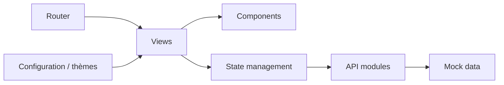

# Daymychen/art-design-pro

> Vue 3 admin dashboard template, for front-end developers building a back office.

## The problem
A back office requires rebuilding layout, routing, themes, tables and forms every time.

## What it actually does
A Vue 3 / TypeScript / Vite template with Element-Plus and Tailwind: views (dashboard, articles, login), components, router, store, mock APIs, themes, ECharts charts. A cleanup script removes the demo data. Quality tooling: ESLint, Prettier, Stylelint, Husky.

## How it is wired


## Trying it
```bash
pnpm install
pnpm dev
pnpm build
pnpm clean:dev
```

## Cost and gotchas
Free. If `pnpm install` fails, the README suggests `--ignore-scripts`. Donations are solicited.

## What it is not
Not a data dashboard framework: a front-end template with no backend provided.

## Alternatives
No alternative named in the README.

## For you
Ignore: for model dashboards, tools like Shiny or visualization libraries are more direct.
