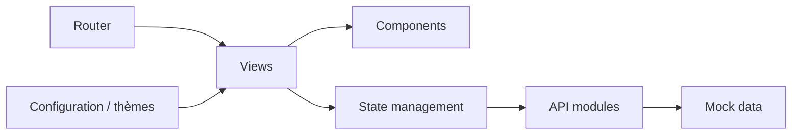

# Daymychen/art-design-pro

> Modèle de tableau de bord d'administration Vue 3, pour développeurs front qui bâtissent un back-office.

## Le problème
Un back-office demande de reconstruire à chaque fois mise en page, routage, thèmes, tableaux et formulaires.

## Ce que ça fait vraiment
Gabarit Vue 3 / TypeScript / Vite avec Element-Plus et Tailwind : vues (tableau de bord, articles, connexion), composants, routeur, store, API simulées (mock), thèmes, graphiques ECharts. Un script de nettoyage retire les données de démonstration. Outils de qualité : ESLint, Prettier, Stylelint, Husky.

## Comment c'est branché


## Essayer
```bash
pnpm install
pnpm dev
pnpm build
pnpm clean:dev
```

## Coût et pièges
Gratuit. Si `pnpm install` échoue, le README propose `--ignore-scripts`. Dons sollicités.

## Ce que ce n'est pas
Pas un framework de tableaux de bord data : un gabarit front sans backend fourni.

## Alternatives
Aucune alternative nommée dans le README.

## Pour toi
À ignorer : pour des tableaux de bord de modèles, des outils comme Shiny ou des bibliothèques de visualisation sont plus directs.

