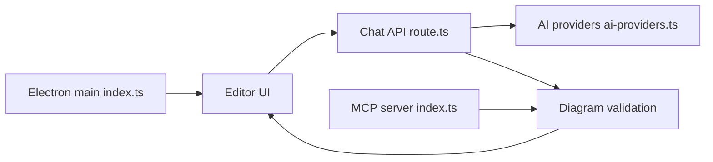

# DayuanJiang/next-ai-draw-io

> Chat-driven draw.io editor: describe a diagram, the AI draws and edits it.

## The problem
Drawing architecture diagrams by hand is slow, and text-based generators offer little visual control.

## What it actually does
Next.js application with a real draw.io canvas: the model produces draw.io XML, which is validated then applied. Each AI change is a comparable, undoable version. Import of images, PDFs and text files. 25 model providers (Bedrock by default). Available as a Web application, desktop (Electron) and MCP server (`@next-ai-drawio/mcp-server`).

## How it is wired


## Trying it
```bash
git clone https://github.com/DayuanJiang/next-ai-draw-io
cd next-ai-draw-io
npm install
cp env.example .env.local
npm run dev
claude mcp add --scope user drawio -- npx @next-ai-drawio/mcp-server@latest
```

## Cost and gotchas
The online demo has a usage limit; your own key lifts it. Small models produce broken diagrams. Usage-logging routes exist in the code.

## What it is not
Not a diagram-as-code tool: the output format is draw.io XML. The README's comparison targets draw.io's native Generate.

## Alternatives
draw.io's built-in Generate (Arrange > Insert > Generate).

## For you
Worth watching: handy for quickly sketching MLOps pipelines, but plan for a reliable API key and review every diagram.
