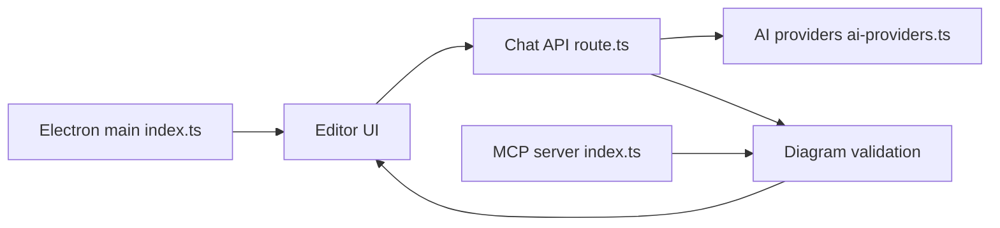

# DayuanJiang/next-ai-draw-io

> Éditeur draw.io piloté par chat : décris un diagramme, l'IA le dessine et le modifie.

## Le problème
Dessiner des diagrammes d'architecture à la main est lent, et les générateurs textuels produisent peu de contrôle visuel.

## Ce que ça fait vraiment
Application Next.js avec un vrai canevas draw.io : le modèle produit du XML draw.io, validé puis appliqué. Chaque changement IA est une version comparable et annulable. Import d'images, PDF et fichiers texte. 25 fournisseurs de modèles (Bedrock par défaut). Disponible en application Web, bureau (Electron) et serveur MCP (`@next-ai-drawio/mcp-server`).

## Comment c'est branché


## Essayer
```bash
git clone https://github.com/DayuanJiang/next-ai-draw-io
cd next-ai-draw-io
npm install
cp env.example .env.local
npm run dev
claude mcp add --scope user drawio -- npx @next-ai-drawio/mcp-server@latest
```

## Coût et pièges
La démo en ligne a une limite d'usage ; ta propre clé la lève. Les petits modèles produisent des diagrammes cassés. Les routes de journalisation d'usage existent dans le code.

## Ce que ce n'est pas
Pas un outil de diagramme-en-code : le format de sortie est du XML draw.io. La comparaison du README vise le Generate natif de draw.io.

## Alternatives
Le Generate intégré à draw.io (Arrange > Insert > Generate).

## Pour toi
À surveiller : pratique pour schématiser rapidement des pipelines MLOps, mais prévois une clé d'API fiable et relis chaque diagramme.

