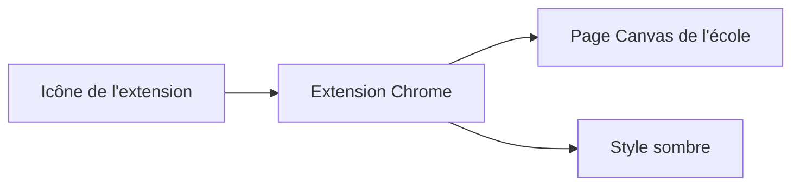

# DeGrandis/canvas-dark-mode

> Chrome extension that adds a dark mode to Canvas LMS for students.

## The problem
Canvas's light interface strains the eyes during long sessions.

## What it actually does
Extension available on the Chrome Web Store. For an institution not yet covered, clicking the icon then "Enable on this site" turns it on. Development is done by loading the unpacked extension in `chrome://extensions/`.

## How it is wired
Simplified diagram based on the sheet, no diagram provided.



## Trying it
```bash
git checkout -b my-branch-name
# puis chrome://extensions/ > Load Unpacked
```

## Cost and gotchas
Free, donations accepted. License not declared. Adding an institution to the list makes Chrome disable the extension for all users until it is approved again.

## What it is not
Not a universal theme: it only covers Canvas.

## Alternatives
No alternative named in the README.

## For you
Ignore: Canvas display comfort, unrelated to data or AI.
