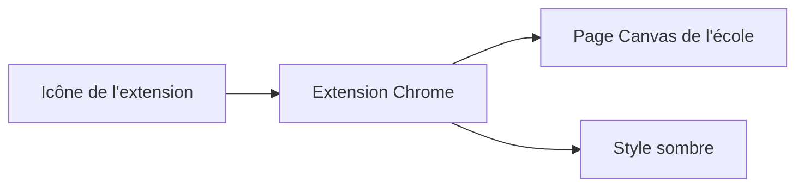

# DeGrandis/canvas-dark-mode

> Extension Chrome qui ajoute un mode sombre à Canvas LMS pour les étudiants.

## Le problème
L'interface claire de Canvas fatigue les yeux lors des longues séances.

## Ce que ça fait vraiment
Extension disponible sur le Chrome Web Store. Pour un établissement non couvert, un clic sur l'icône puis « Enable on this site » l'active. Le développement se fait en chargeant l'extension non empaquetée dans `chrome://extensions/`.

## Comment c'est branché
Schéma simplifié d'après la fiche, sans diagramme fourni.



## Essayer
```bash
git checkout -b my-branch-name
# puis chrome://extensions/ > Load Unpacked
```

## Coût et pièges
Gratuit, dons acceptés. Licence non déclarée. Ajouter un établissement à la liste force Chrome à désactiver l'extension pour tous les utilisateurs jusqu'à nouvelle approbation.

## Ce que ce n'est pas
Pas un thème universel : il ne couvre que Canvas.

## Alternatives
Aucune alternative nommée dans le README.

## Pour toi
À ignorer : confort d'affichage Canvas, sans rapport avec la data ou l'IA.

