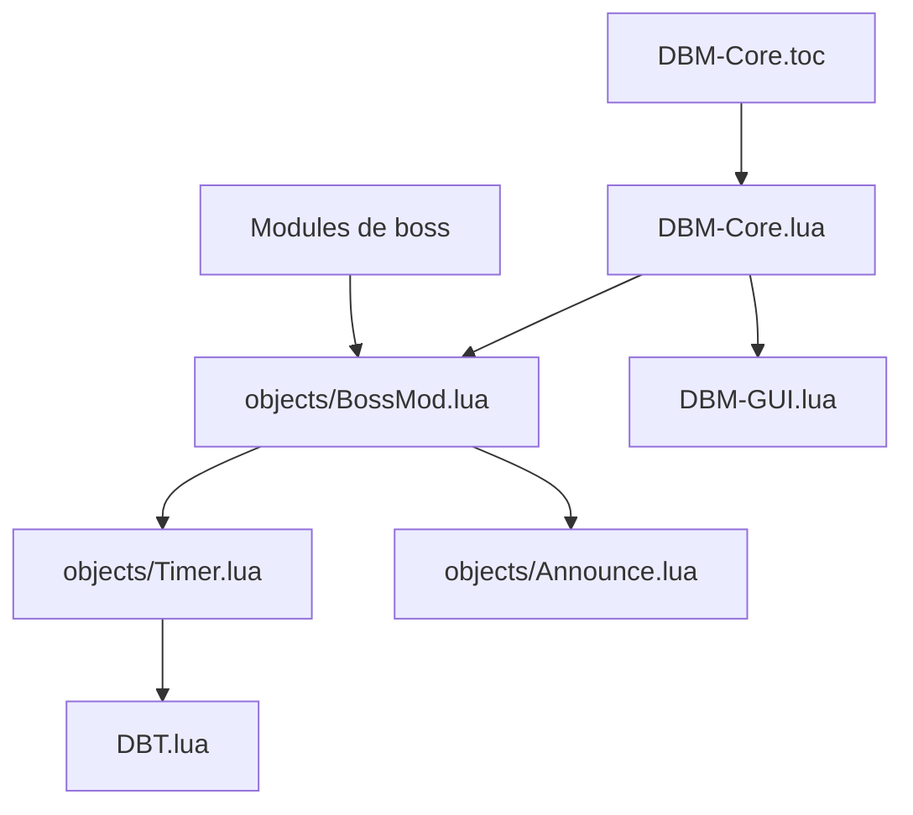

# DeadlyBossMods/DeadlyBossMods

> Modular World of Warcraft addon that announces boss fight mechanics, for players in raids.

## The problem
During a boss fight, you have to spot each enemy ability in time without watching the combat logs.

## What it actually does
Colored alerts, timer bars, info frames, role filters, automatic replies to messages during a fight, and timer recovery after a disconnection. Boss modules are addons loaded on demand, with voice and countdown packs in several languages.

## How it is wired


## Trying it
```text
/dbm
/dbm help
```

## Cost and gotchas
Free. Older content is in separate packages to install as needed. The license is present but not identified.

## What it is not
Not an out-of-game tool: it only works inside the game client.

## Alternatives
No alternative named in the README.

## For you
Ignore: a game addon with no connection to data, AI or MLOps work.
