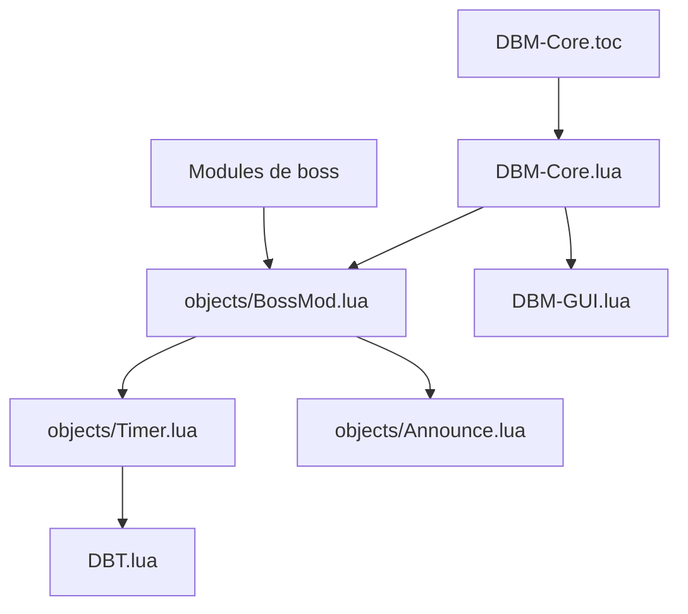

# DeadlyBossMods/DeadlyBossMods

> Addon World of Warcraft modulaire qui annonce les mécaniques de combats de boss, pour les joueurs en raid.

## Le problème
Pendant un combat de boss, il faut repérer à temps chaque capacité ennemie sans surveiller les journaux de combat.

## Ce que ça fait vraiment
Alertes colorées, barres de temps, cadres d'information, filtres par rôle, réponses automatiques aux messages pendant un combat et récupération des minuteurs après une déconnexion. Les modules de boss sont des addons chargés à la demande, avec des packs de voix et de décomptes en plusieurs langues.

## Comment c'est branché


## Essayer
```text
/dbm
/dbm help
```

## Coût et pièges
Gratuit. Les anciens contenus sont dans des paquets séparés à installer au besoin. La licence est présente mais non identifiée.

## Ce que ce n'est pas
Pas un outil hors jeu : il ne fonctionne que dans le client du jeu.

## Alternatives
Aucune alternative nommée dans le README.

## Pour toi
À ignorer : un addon de jeu sans lien avec un travail data, IA ou MLOps.

