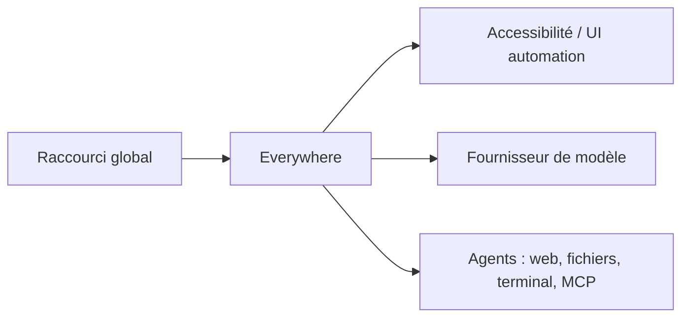

# DearVa/Everywhere

> Desktop AI assistant that reads the screen context on a keyboard shortcut, for Windows and macOS.

## The problem
Querying an LLM forces you to copy, switch windows, paste and rephrase.

## What it actually does
Summoned by a shortcut, it perceives screen content through accessibility APIs and UI automation, with no manual capture. It connects to OpenAI, Anthropic, Gemini, DeepSeek, Kimi, MiniMax, Ollama or a custom endpoint. Agents: browser, local files, terminal scripts, MCP tools, sub-agents. The contextual strategy engine is still under construction.

## How it is wired

## Trying it
No documented command. Download the Windows installer (`Everywhere-Windows-x64-Setup-vx.x.x.exe`) or the macOS `.pkg` from the releases.

## Cost and gotchas
The provider's API key is at your expense, or the publisher's cloud service (pricing not documented). Screen and terminal access requires trust. README truncated after the macOS installation.

## What it is not
Not available on Linux (in development). Not local by default: the screen context is sent to the chosen model.

## Alternatives
No alternative named in the README.

## For you
Worth watching: a useful idea but young, a single author, license to be confirmed and screen context sent to third parties.
