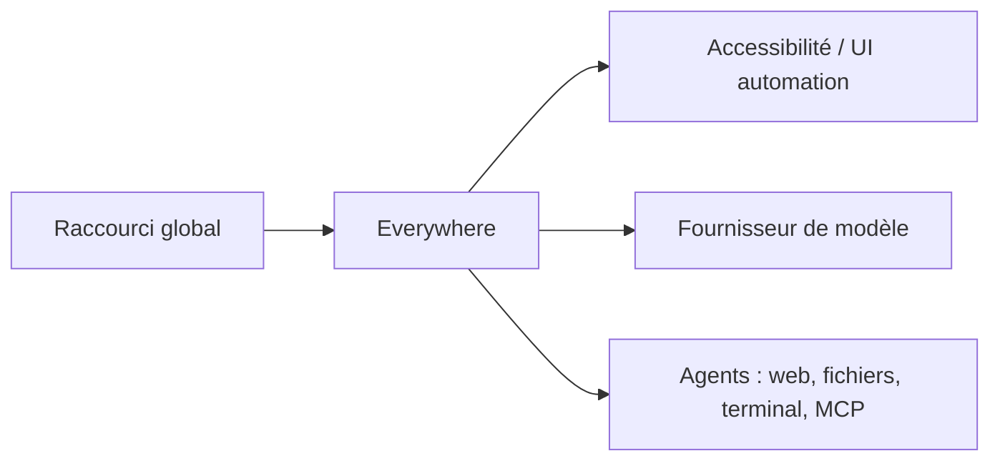

# DearVa/Everywhere

> Assistant IA de bureau qui lit le contexte de l'écran sur raccourci clavier, pour Windows et macOS.

## Le problème
Interroger un LLM oblige à copier, changer de fenêtre, coller et reformuler.

## Ce que ça fait vraiment
Appelé par raccourci, il perçoit le contenu de l'écran via les API d'accessibilité et l'automatisation d'interface, sans capture manuelle. Il se branche à OpenAI, Anthropic, Gemini, DeepSeek, Kimi, MiniMax, Ollama ou un endpoint personnalisé. Agents : navigateur, fichiers locaux, scripts terminal, outils MCP, sous-agents. Le moteur de stratégies contextuelles est encore en chantier.

## Comment c'est branché

## Essayer
Aucune commande documentée. Télécharger l'installeur Windows (`Everywhere-Windows-x64-Setup-vx.x.x.exe`) ou le `.pkg` macOS depuis les releases.

## Coût et pièges
Clé d'API du fournisseur à ta charge, ou service cloud de l'éditeur (tarifs non documentés). L'accès à l'écran et au terminal exige de la confiance. README tronqué après l'installation macOS.

## Ce que ce n'est pas
Pas disponible sur Linux (en développement). Pas local par défaut : le contexte écran part vers le modèle choisi.

## Alternatives
Aucune alternative nommée dans le README.

## Pour toi
À surveiller : idée utile mais jeune, un seul auteur, licence à confirmer et contexte d'écran envoyé à des tiers.

