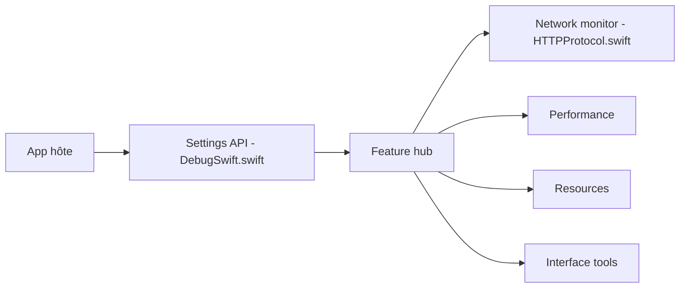

# DebugSwift/DebugSwift

> Embedded debugging toolkit for Swift iOS apps, with a network and performance inspector.

## The problem
Debugging a running iOS app often takes several separate tools for network, memory and interface.

## What it actually does
A library injected into the app in debug builds: HTTP and WebSocket inspector (with response modification), CPU/memory/FPS metrics, leak detection, crash reports, console, file browser, UserDefaults, Keychain, SQLite/Realm/SwiftData databases, 3D view hierarchy, push notification simulation. It relies on swizzling and `URLProtocol` interception. A floating button opens the menu.

## How it is wired


## Trying it
```swift
import DebugSwift
#if DEBUG
debugSwift.setup()
debugSwift.show()
#endif
```
Installation: Swift Package Manager (`https://github.com/DebugSwift/DebugSwift`) or `pod 'DebugSwift'`.

## Cost and gotchas
Requires iOS 14+, Swift 6, Xcode 16. Wrap it in `#if DEBUG`: it exposes files, Keychain and network traffic. The SwiftUI features and the network session history are in beta.

## What it is not
Not a production monitoring tool. It does not cover platforms other than iOS.

## Alternatives
CocoaDebug and DBDebugToolkit, cited as references in the README.

## For you
Ignore: an iOS debugging tool, outside the data, AI or MLOps scope.
