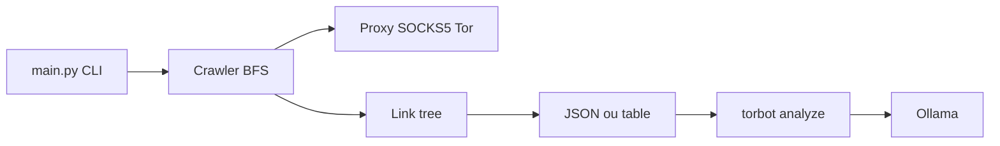

# DedSecInside/TorBot

> Command-line OSINT tool for exploring .onion sites, with optional AI analysis.

## The problem
Mapping dark web sites and extracting usable elements from them takes time by hand.

## What it actually does
BFS crawler of .onion links or open domains: title, live-link checking, tree exported as JSON, tree or table visualization. `torbot analyze` produces an investigation file cited from a crawl result, with local Ollama by default; remote requires `--allow-remote`. Database saving and screenshot capture are still to do.

## How it is wired


## Trying it
```sh
python3 -m venv .venv
source .venv/bin/activate
python -m pip install -r requirements.txt
python -m pip install -e .
python main.py -u https://example.com --depth 2 --visualize table
```

## Cost and gotchas
Free. Tor optional; otherwise `--disable-socks5`. Legal and security risk to assess before visiting .onion content.

## What it is not
Not a hardened anonymity tool (to-do list: increase anonymity). Several announced features are "Not done".

## Alternatives
No alternative cited in the README.

## For you
Worth watching: evidence-based AI analysis is an interesting idea, but the tool is still young and its OSINT scope is narrow.
