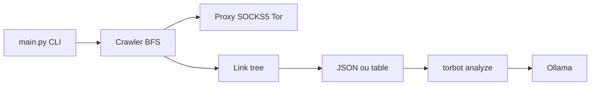

# DedSecInside/TorBot

> Outil OSINT en ligne de commande pour explorer des sites .onion, avec analyse IA optionnelle.

## Le problème
Cartographier des sites du dark web et en tirer des éléments exploitables prend du temps à la main.

## Ce que ça fait vraiment
Crawler (BFS) de liens .onion ou de domaines libres : titre, vérification de liens vivants, arbre exporté en JSON, visualisation en arbre ou tableau. `torbot analyze` produit un dossier d'enquête cité depuis un résultat de crawl, avec Ollama local par défaut ; le distant exige `--allow-remote`. Sauvegarde en base et capture d'écran restent à faire.

## Comment c'est branché


## Essayer
```sh
python3 -m venv .venv
source .venv/bin/activate
python -m pip install -r requirements.txt
python -m pip install -e .
python main.py -u https://example.com --depth 2 --visualize table
```

## Coût et pièges
Gratuit. Tor optionnel ; sinon `--disable-socks5`. Risque légal et de sécurité à évaluer avant de visiter des contenus .onion.

## Ce que ce n'est pas
Pas un outil d'anonymat renforcé (liste de tâches : augmenter l'anonymat). Plusieurs fonctions annoncées sont « Not done ».

## Alternatives
Aucune alternative citée dans le README.

## Pour toi
À surveiller : l'analyse IA fondée sur preuves est une idée intéressante, mais l'outil reste jeune et son champ OSINT est étroit.

