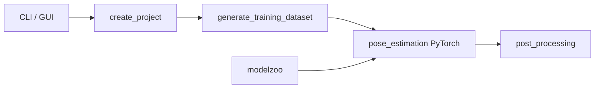

# DeepLabCut/DeepLabCut

> Markerless pose estimation toolbox for animals and objects, with a GUI.

## The problem
Tracking an animal's movements on video used to require physical markers or a full-time annotator.

## What it actually does
Project creation, labeling, training dataset generation, training, video analysis, post-processing.
PyTorch backend since v3.0 (TensorFlow being phased out), multi-animal, multi-camera 3D.
Pre-trained SuperAnimal models (quadrupeds, top-view mouse); separate real-time package.
GUI and Python API; Colab demos.

## How it is wired

(The supplied GitDiagram graph is empty: nodes taken from the architecture explanation.)

## Trying it
```bash
pip install torch torchvision
pip install --pre "deeplabcut[gui]"
```

## Cost and gotchas
Free; a CUDA GPU is recommended, and PyTorch/CUDA versions must match. Python 3.10+.

## What it is not
Not a general-purpose detector that needs no annotation: you have to label a few images, unless you settle for the SuperAnimal models. LGPL-3.0.

## Alternatives
No alternative named in the README.

## For you
Worth watching: the essential reference if a project involves animal behavior or biomechanics, useless outside that niche.
