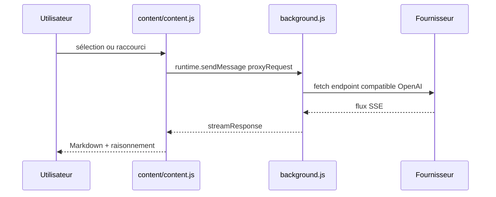

# DeepLifeStudio/DeepSeekAI

> Chrome/Edge extension that opens a floating DeepSeek chat, or any OpenAI-compatible endpoint, on the selected text.

## The problem
Asking a question about a passage of a page means copying the text into a chat tab, then coming back.

## What it actually does
Shows a quick-action bubble on the selection (chat, copy, translation into 19 languages, explanation, summary, email, analysis) and a draggable floating chat with streaming, collapsible R1 reasoning, copy and regeneration. Handles several providers with their key, URL and models, a global system prompt, two keyboard shortcuts and a context menu. Markdown, KaTeX and syntax highlighting rendering, sanitized by DOMPurify.

## How it is wired


## Trying it
```bash
pnpm install
pnpm run build        # sortie dans dist/
# chrome://extensions > Mode développeur > Charger l'extension non empaquetée > dist
pnpm run build:chrome # chrome-submission.zip
pnpm run build:edge   # edge-submission.zip
```

## Cost and gotchas
You need your own API key (DeepSeek or other): the selected text is sent to the configured endpoint. Keys and preferences live in `chrome.storage.sync`. Providers other than DeepSeek require an explicit model identifier.

## What it is not
Not an agent: it only does chat on text. No intermediate server, but no native integration with page content beyond the selection either.

## Alternatives
No alternative named in the README.

## For you
Worth watching: simple reading assistant, no announced telemetry, with an entry point at your key; of little interest if you already use a chat client or an IDE.
