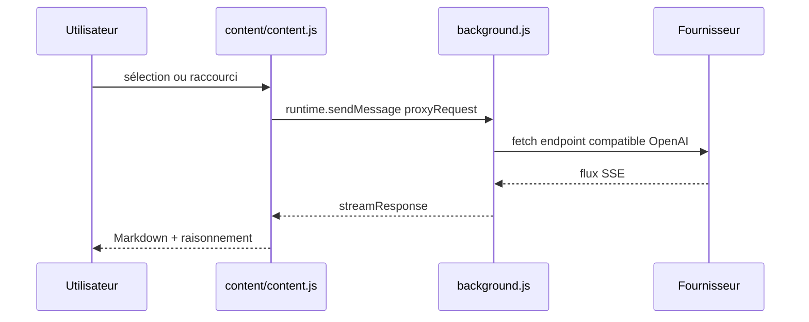

# DeepLifeStudio/DeepSeekAI

> Extension Chrome/Edge qui ouvre un chat flottant DeepSeek, ou tout endpoint compatible OpenAI, sur le texte sélectionné.

## Le problème
Poser une question sur un passage de page oblige à copier le texte vers un onglet de chat, puis à revenir.

## Ce que ça fait vraiment
Affiche une bulle d'actions rapides sur la sélection (chat, copie, traduction en 19 langues, explication, résumé, e-mail, analyse) et un chat flottant déplaçable avec streaming, raisonnement R1 repliable, copie et régénération. Gère plusieurs fournisseurs avec leur clé, URL et modèles, un prompt système global, deux raccourcis clavier et un menu contextuel. Rendu Markdown, KaTeX et coloration, assainis par DOMPurify.

## Comment c'est branché


## Essayer
```bash
pnpm install
pnpm run build        # sortie dans dist/
# chrome://extensions > Mode développeur > Charger l'extension non empaquetée > dist
pnpm run build:chrome # chrome-submission.zip
pnpm run build:edge   # edge-submission.zip
```

## Coût et pièges
Il faut ta propre clé d'API (DeepSeek ou autre) : le texte sélectionné part vers l'endpoint configuré. Clés et préférences vivent dans `chrome.storage.sync`. Les fournisseurs autres que DeepSeek demandent un identifiant de modèle explicite.

## Ce que ce n'est pas
Pas un agent : il ne fait que du chat sur du texte. Pas de serveur intermédiaire, mais pas non plus d'intégration native avec le contenu des pages au-delà de la sélection.

## Alternatives
Aucune alternative nommée dans le README.

## Pour toi
À surveiller : assistant de lecture simple, sans télémétrie annoncée, avec un point d'entrée à ta clé ; de peu d'intérêt si tu utilises déjà un client de chat ou une IDE.

