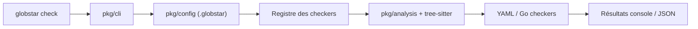

# DeepSourceCorp/globstar

> Go static analysis toolkit for writing code checkers with tree-sitter queries.

## The problem
Applying your team's own code rules (security, performance) forces you to pick generic rules or build in-house tooling.

## What it actually does
A single binary (`globstar check`) runs the built-in checkers and those in the `.globstar` folder. Each simple rule is a YAML file with a tree-sitter query; advanced rules are written in Go with access to the AST and scope resolution. It integrates into CI and reports the problems found.

## How it is wired


## Trying it
```bash
curl -sSL https://get.globstar.dev | sh
./bin/globstar check
curl -sSL https://get.globstar.dev | BINDIR=$HOME/.local/bin sh
mv ./bin/globstar /usr/local/bin
```

## Cost and gotchas
Free, no dependencies. The install script is run via `curl | sh`. You have to learn the tree-sitter query syntax.

## What it is not
Not a turnkey analyzer with exhaustive rules: its value comes from your rules. Integration with DeepSource is announced as future.

## Alternatives
The README names no alternative (it mentions DeepSource's proprietary analyzers).

## For you
Worth watching: handy for enforcing in-house rules (secrets, dangerous calls) in data/AI code repositories, to be tested on a specific case.
