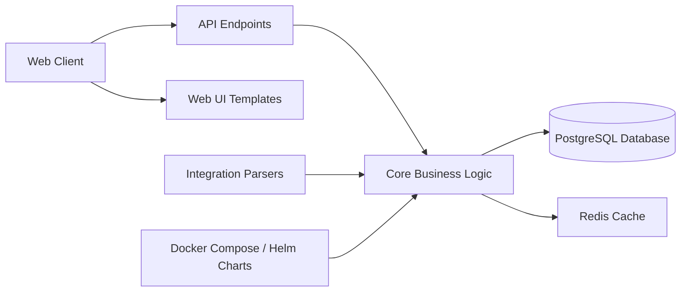

# DefectDojo/django-DefectDojo

> Django application that centralizes, deduplicates and tracks vulnerabilities from scanners, for DevSecOps teams.

## The problem
Each scanner produces its own report. Without a central point, the same flaws are counted several times and their remediation is tracked nowhere.

## What it actually does
- Imports reports from many tools via parsers (`dojo/tools`) and normalizes them into "findings".
- Deduplicates, handles risk acceptance, engagements, products and notifications.
- Exposes a REST API (`dojo/api_v2`) and produces reports.
- The community edition has local accounts; SSO (SAML, OIDC, OAuth), LDAP and MFA are reserved for the paid Pro edition.

## How it is wired


## Trying it
```bash
git clone https://github.com/DefectDojo/django-DefectDojo && cd django-DefectDojo && docker compose up
docker compose logs initializer | grep "Admin password:"
```

## Cost and gotchas
Docker required; the first initialization can take up to 3 minutes. Enterprise authentication features and the risk-based prioritization engine are in the Pro offering. Public demos are reset every day: put no sensitive data there.

## What it is not
It is not a scanner: it detects nothing, it aggregates the results of other tools. The free edition does not include SSO or MFA. The README does not document scaling for the community edition.

## Alternatives
No alternative named in the README.

## For you
Watch: relevant if you manage security scans of a CI/CD chain (models, images, dependencies), but the free edition is limited on authentication and steering.
