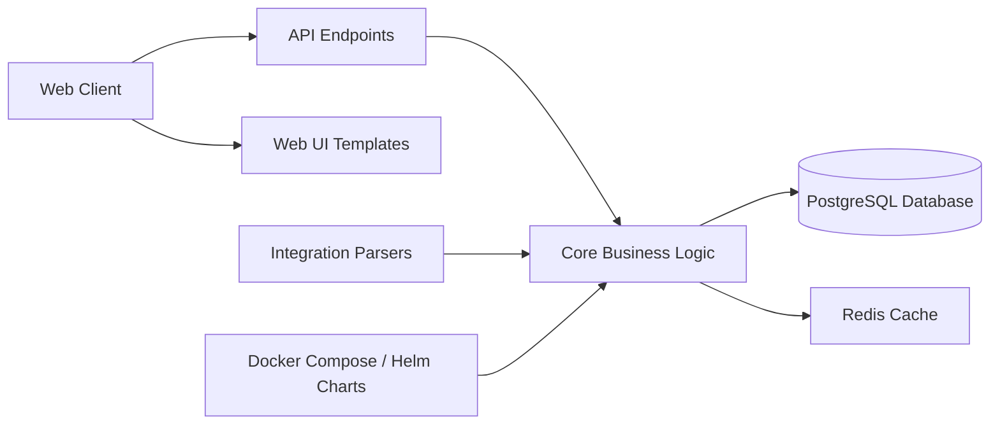

# DefectDojo/django-DefectDojo

> Application Django qui centralise, dédoublonne et suit les vulnérabilités issues de scanners, pour équipes DevSecOps.

## Le problème
Chaque scanner produit son propre rapport. Sans point central, les mêmes failles sont comptées plusieurs fois et leur correction n'est suivie nulle part.

## Ce que ça fait vraiment
- Importe des rapports de nombreux outils via des parseurs (`dojo/tools`) et les normalise en « findings ».
- Dédoublonne, gère acceptation de risque, engagements, produits et notifications.
- Expose une API REST (`dojo/api_v2`) et produit des rapports.
- L'édition communautaire a des comptes locaux ; SSO (SAML, OIDC, OAuth), LDAP et MFA sont réservés à l'édition Pro payante.

## Comment c'est branché


## Essayer
```bash
git clone https://github.com/DefectDojo/django-DefectDojo && cd django-DefectDojo && docker compose up
docker compose logs initializer | grep "Admin password:"
```

## Coût et pièges
Docker requis ; la première initialisation peut prendre jusqu'à 3 minutes. Les fonctions d'authentification d'entreprise et le moteur de priorisation par risque sont dans l'offre Pro. Les démos publiques sont remises à zéro chaque jour : n'y mettre aucune donnée sensible.

## Ce que ce n'est pas
Ce n'est pas un scanner : il ne détecte rien, il agrège les résultats d'autres outils. L'édition libre n'inclut pas SSO ni MFA. Le README ne documente pas de mise à l'échelle pour l'édition communautaire.

## Alternatives
Aucune alternative nommée dans le README.

## Pour toi
Surveiller : pertinent si tu gères les scans de sécurité d'une chaîne CI/CD (modèles, images, dépendances), mais l'édition libre est limitée côté authentification et pilotage.

