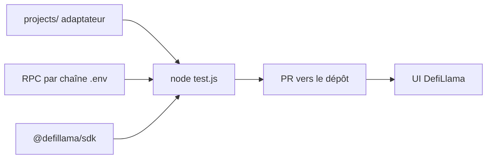

# DefiLlama/DefiLlama-Adapters

> Repository of adapters that compute the TVL of DeFi protocols for DefiLlama, open to contributions.

## The problem
The total value locked (TVL) of DeFi protocols must be computed from the blockchain in a transparent and verifiable way.

## What it actually does
One adapter per protocol under `projects/` computes the TVL from on-chain data; a `test.js` script runs it, at a given date if needed. The repository is reserved for TVL; volumes and fees go in dimension-adapters. An agent skill `skills/adapter-author/` helps write an adapter. RPCs can be overridden through `.env`.

## How it is wired


## Trying it
```bash
node test.js projects/pangolin/index.js
node test.js projects/aave/v3.js 2024-10-16
```

## Cost and gotchas
Public RPCs by default; an archive node may be needed for history. No additional npm packages are accepted. Do not modify `pnpm-lock.yaml`. No license declared.

## What it is not
Not a general-purpose library nor a data API: it is a contribution repository for a third-party service.

## Alternatives
- DefiLlama/dimension-adapters for volume, fees, revenue (cited in the README).

## For you
Ignore for data/AI/MLOps, unless you contribute to DefiLlama; the missing license also hinders any reuse.
