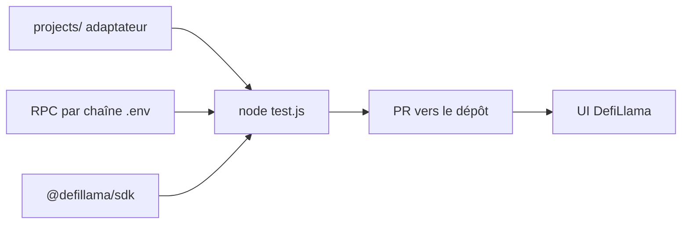

# DefiLlama/DefiLlama-Adapters

> Dépôt d'adaptateurs qui calculent la TVL de protocoles DeFi pour DefiLlama, ouvert aux contributions.

## Le problème
La valeur verrouillée (TVL) des protocoles DeFi doit être calculée depuis la blockchain de façon transparente et vérifiable.

## Ce que ça fait vraiment
Un adaptateur par protocole sous `projects/` calcule la TVL à partir des données chaînes ; un script `test.js` l'exécute, à une date donnée si besoin. Le dépôt est réservé à la TVL ; volumes et frais vont dans dimension-adapters. Un skill d'agent `skills/adapter-author/` aide à écrire un adaptateur. Les RPC se surchargent par `.env`.

## Comment c'est branché


## Essayer
```bash
node test.js projects/pangolin/index.js
node test.js projects/aave/v3.js 2024-10-16
```

## Coût et pièges
RPC publics par défaut ; un nœud archive peut être nécessaire pour l'historique. Aucun paquet npm supplémentaire accepté. Ne pas modifier `pnpm-lock.yaml`. Aucune licence déclarée.

## Ce que ce n'est pas
Pas une bibliothèque générale ni une API de données : c'est un dépôt de contribution pour un service tiers.

## Alternatives
- DefiLlama/dimension-adapters pour volume, frais, revenus (cité dans le README).

## Pour toi
À ignorer pour la data/IA/MLOps, sauf si tu contribues à DefiLlama ; la licence absente freine aussi tout réemploi.

