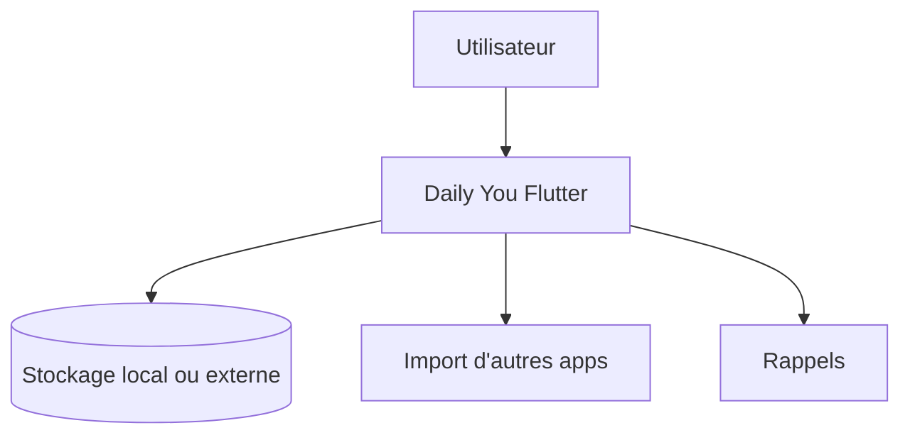

# Demizo/Daily_You

> Offline Android personal journal with mood tracking, no account and no data collection.

## The problem
Digital journals are often subscriptions that lock in your data.

## What it actually does
Daily entries in Markdown, mood tracking, photos, random reminders, storage of your choice including external. Import from other applications via the settings. Works offline, with no account and no ads.

## How it is wired
Simplified diagram based on the fiche, no diagram provided.


## Trying it
```bash
nix develop
flutter pub get
```
These commands are for development; the README points to a download link not reproduced in the text.

## Cost and gotchas
Free, no external service. No synchronization between devices is described: you handle backup and external backup yourself.

## What it is not
Not a collaborative notes app. Imports from other apps are not always one-to-one equivalent.

## Alternatives
No alternative named in the README.

## For you
Ignore: personal journal unrelated to the data / AI / MLOps profession.
