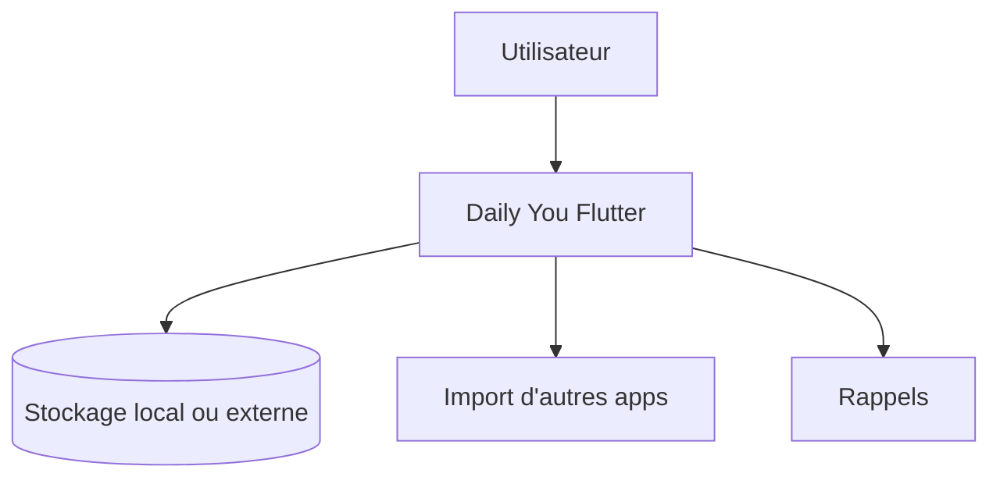

# Demizo/Daily_You

> Journal intime Android hors ligne, avec suivi d'humeur, sans compte ni collecte de données.

## Le problème
Les journaux numériques sont souvent des abonnements qui enferment tes données.

## Ce que ça fait vraiment
Entrées quotidiennes en Markdown, suivi d'humeur, photos, rappels aléatoires, stockage au choix y compris externe. Importation depuis d'autres applications via les réglages. Fonctionne hors ligne, sans compte ni publicité.

## Comment c'est branché
Schéma simplifié d'après la fiche, sans diagramme fourni.


## Essayer
```bash
nix develop
flutter pub get
```
Ces commandes servent au développement ; le README renvoie à un lien de téléchargement non reproduit dans le texte.

## Coût et pièges
Gratuit, sans service externe. Aucune synchronisation entre appareils n'est décrite : tu gères toi-même sauvegarde et sauvegarde externe.

## Ce que ce n'est pas
Pas une app de notes collaboratives. Les imports depuis d'autres apps ne sont pas toujours équivalents un pour un.

## Alternatives
Aucune alternative nommée dans le README.

## Pour toi
À ignorer : journal personnel sans rapport avec le métier data / IA / MLOps.

