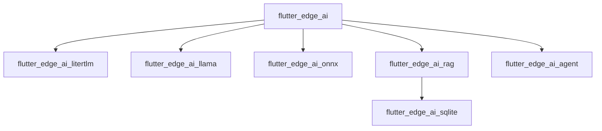

# DenisovAV/flutter_gemma

> Set of Flutter packages to run AI models on the device, with no server or cloud.

## The problem
Embedding an LLM, embeddings or voice in a Flutter application means integrating several inference engines yourself.

## What it actually does
A `flutter_edge_ai` core installs the models and hands them to optional engines: LiteRT-LM, MediaPipe, llama.cpp (GGUF), ONNX Runtime, OS built-in model. Separate packages for embeddings, RAG (SQLite, Qdrant), voice, agent skills and Genkit.

## How it is wired

## Trying it
No command in this README: it points to the core README and the getting-started guide. Example application in `packages/flutter_edge_ai/example`.

## Cost and gotchas
Free, but models are downloaded and are heavy on mobile. Support varies by platform and engine. The old `flutter_gemma*` names remain published as-is until core 1.11.4.

## What it is not
Not a model or a service: integration packages. Not a solution outside Flutter.

## Alternatives
None cited in the README.

## For you
Worth watching: useful if you bring on-device AI to mobile with Flutter, otherwise outside your scope.
